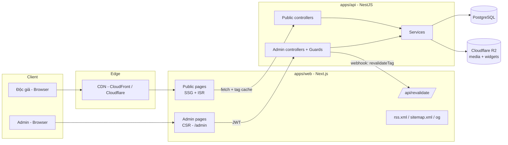

# ARCHITECTURE — Blog "Salmon Lab" (Next.js + NestJS)

> Tài liệu kiến trúc để implement blog **Salmon Lab**, lấy **https://fromcodetocloud.info/** làm site mẫu về cấu trúc và giao diện
> Frontend: **Next.js** · Backend: **NestJS** · Ngôn ngữ nội dung: tiếng Việt (`vi_VN`)

---

## 0. Phạm vi & cách tài liệu này được tạo

Tài liệu được viết sau khi khám phá các trang công khai của site gốc: Trang chủ, `/posts/`, một bài viết chi tiết, `/notes/`, `/infographic/` (kèm một infographic), `/posts/back-to-basics/` (series), `/about/`.

**Những gì quan sát trực tiếp được từ site gốc:**
- Site gốc dựng bằng **Hugo 0.135** (static), nội dung tiếng Việt, có RSS (`/index.xml`).
- Điều hướng: Trang chủ · Bài viết · Ghi chú · Infographic · trang cá nhân (`/about/`) · RSS.
- Trang chủ: ảnh cover, mô tả site, form đăng ký email *(Salmon Lab không làm)*, mục **Nổi bật** (bài/series ghim), **Bài viết gần đây**, **Ghi chú gần đây**.
- Bài viết: ảnh bìa, ngày đăng, **số từ + thời gian đọc** ("338 từ · 2 phút đọc"), nội dung dài, link "← Tất cả bài viết".
- Danh sách bài viết: nhóm theo **năm**, lọc theo category (`KHCN`, `Khác`).
- Ghi chú: dòng thời gian (timeline) các ghi chép ngắn, lọc theo **năm / tháng**, mỗi ghi chú có permalink dạng `/notes/20261014162946-eb34/` (timestamp + 4 ký tự hex).
- Infographic: trang tương tác (sơ đồ, hoạt hình, mô phỏng bấm thử), có mục lục các chương, ảnh cover, thuộc một **series** (ví dụ *Back-To-Basics*), cần JavaScript để chạy.
- Series: trang riêng, ảnh bìa, danh sách mục theo thứ tự.
- Đăng ký email nhận bài mới: site mẫu có, nhưng **Salmon Lab không làm chức năng gửi mail** (xem mục 1).
- SEO: Open Graph, Twitter Card, canonical, `og:locale = vi_VN`, ảnh OG 2400×1260.

**Những gì suy luận (không nhìn thấy trực tiếp):**
- Bài "Xây dựng hệ thống quản trị cá nhân < 1$/tháng" cho biết tác giả có hệ thống quản trị riêng (sổ tay kiểu Notion, soạn và xuất bản blog/ghi chú/sách lên website public). Vì vậy kiến trúc dưới đây có **Admin CMS** — đây là phần suy luận để đáp ứng việc có backend NestJS, bạn có thể cắt giảm.

---

## 1. Mục tiêu & phi mục tiêu

### Mục tiêu
1. Đọc nhanh, SEO tốt (blog công khai) → render tĩnh/ISR.
2. Ba loại nội dung chính: **Bài viết (Post)**, **Ghi chú (Note)**, **Infographic** — cộng thêm **Series** và **Trang tĩnh (About)**.
3. Admin viết/sửa/xuất bản nội dung bằng Markdown, upload ảnh.
4. Theo dõi bài mới qua **RSS** (không có chức năng gửi email).
5. RSS, sitemap, OG image.
6. Chi phí vận hành thấp, deploy tự động.

### Phi mục tiêu (giai đoạn đầu)
- **Gửi email / đăng ký nhận bài qua email** (đã chủ động loại bỏ; người đọc theo dõi bằng RSS).
- Bình luận, đa tác giả, phân quyền phức tạp.
- Paywall / bán khóa học.
- Đa ngôn ngữ (chỉ `vi`, nhưng thiết kế không chặn mở rộng sau).

---

## 2. Tech stack đề xuất

| Lớp | Lựa chọn | Ghi chú |
|---|---|---|
| Monorepo | **pnpm workspaces + Turborepo** | Chia sẻ type/schema giữa web và api |
| Frontend | **Next.js 15 (App Router) + React 19 + TypeScript** | SSG/ISR cho trang public, CSR cho admin |
| Styling | **Tailwind CSS** + `@tailwindcss/typography` | Giao diện tối giản như site gốc |
| Render Markdown | `unified` (remark + rehype) + **Shiki** | Highlight code, heading anchor, bảng, footnote |
| Backend | **NestJS 10+ (TypeScript)** | REST API, module hóa |
| ORM | **Prisma** (hoặc TypeORM nếu bạn quen hơn) | Migration + type-safe |
| Database | **PostgreSQL 16** | Full-text search với `unaccent` + `pg_trgm` |
| Lưu file | **Cloudflare R2** (S3-compatible) | Ảnh bìa, ảnh trong bài, file widget; xem mục 10 |
| Auth | JWT (access) + refresh token cookie `httpOnly` | Admin duy nhất, mật khẩu băm bằng **argon2** |
| Validation | `zod` (shared) hoặc `class-validator` | Chia sẻ schema ở `packages/shared` |
| API docs | `@nestjs/swagger` | OpenAPI → có thể generate client cho web |
| Test | Jest (api), Vitest + Testing Library (web), Playwright (e2e) | |
| CI/CD | GitHub Actions | Build, test, deploy |

---

## 3. Kiến trúc tổng thể



### Nguyên tắc
1. **Trang public không gọi API lúc người dùng truy cập** nếu có thể: Next build/ISR lấy dữ liệu từ API, kết quả cache ở CDN. Độc giả đọc blog ngay cả khi API chậm.
2. **Invalidate theo sự kiện**: khi admin publish/sửa, API gọi `POST /api/revalidate` của Next (kèm secret) để `revalidateTag(...)`.
3. **API là nguồn sự thật duy nhất** (DB + R2). Next không truy cập DB trực tiếp.
4. **Admin tách biệt public**: cùng app Next nhưng route `/admin/*` là client-rendered, `noindex`, bảo vệ bằng middleware.

---

## 4. Cấu trúc thư mục (monorepo)

```
blog/
├─ apps/
│  ├─ web/                          # Next.js
│  │  ├─ src/
│  │  │  ├─ app/
│  │  │  │  ├─ (site)/
│  │  │  │  │  ├─ layout.tsx       # header, footer, nav
│  │  │  │  │  ├─ page.tsx         # Trang chủ
│  │  │  │  │  ├─ posts/
│  │  │  │  │  │  ├─ page.tsx      # Danh sách theo năm
│  │  │  │  │  │  └─ [slug]/page.tsx
│  │  │  │  │  ├─ notes/
│  │  │  │  │  │  ├─ page.tsx      # Timeline + lọc năm/tháng
│  │  │  │  │  │  └─ [slug]/page.tsx
│  │  │  │  │  ├─ infographic/
│  │  │  │  │  │  ├─ page.tsx
│  │  │  │  │  │  └─ [slug]/page.tsx
│  │  │  │  │  ├─ series/[slug]/page.tsx
│  │  │  │  │  └─ about/page.tsx
│  │  │  │  ├─ admin/               # CSR, noindex
│  │  │  │  │  ├─ login/page.tsx
│  │  │  │  │  ├─ posts/ notes/ infographics/ series/ media/
│  │  │  │  ├─ api/revalidate/route.ts
│  │  │  │  ├─ rss.xml/route.ts     # hoặc index.xml để giữ URL cũ
│  │  │  │  ├─ sitemap.ts
│  │  │  │  └─ robots.ts
│  │  │  ├─ components/
│  │  │  │  ├─ layout/ (Header, Footer, Nav)
│  │  │  │  ├─ content/ (PostCard, NoteCard, InfographicCard, Markdown, TOC)
│  │  │  │  └─ admin/ (Editor, MediaPicker, DataTable)
│  │  │  ├─ components/content/WidgetFrame.tsx   # iframe sandbox (mục 9)
│  │  │  ├─ lib/ (api-client.ts, markdown.ts, seo.ts, reading-time.ts)
│  │  │  └─ middleware.ts           # bảo vệ /admin
│  │  └─ next.config.ts
│  └─ api/                          # NestJS
│     └─ src/
│        ├─ main.ts
│        ├─ app.module.ts
│        ├─ common/ (guards, filters, interceptors, pipes, decorators)
│        ├─ config/
│        ├─ prisma/
│        └─ modules/
│           ├─ auth/
│           ├─ posts/
│           ├─ notes/
│           ├─ widgets/             # upload, kiểm tra, inject script (mục 9)
│           ├─ series/
│           ├─ taxonomy/            # category + tag
│           ├─ pages/               # about...
│           ├─ media/
│           ├─ feed/                # dữ liệu cho RSS/sitemap
│           ├─ search/
│           └─ revalidate/          # gọi webhook sang Next
├─ packages/
│  ├─ shared/                       # DTO, zod schema, enum, type dùng chung
│  └─ config/                       # eslint, tsconfig, prettier base
├─ infra/                           # docker-compose, terraform (tùy chọn)
├─ .github/workflows/
├─ turbo.json
└─ pnpm-workspace.yaml
```

---

## 5. Mô hình dữ liệu (PostgreSQL / Prisma)

```prisma
enum ContentStatus { DRAFT  PUBLISHED  ARCHIVED }
enum PostKind { POST  INFOGRAPHIC }          // xem mục 9

model User {
  id           String   @id @default(cuid())
  email        String   @unique
  passwordHash String
  displayName  String
  avatarUrl    String?
  createdAt    DateTime @default(now())
  posts        Post[]
  notes        Note[]
}

model Category {            // KHCN, Khác
  id    String @id @default(cuid())
  slug  String @unique
  name  String
  posts Post[]
  notes Note[]
}

model Tag {                 // "tản mạn", ...
  id    String @id @default(cuid())
  slug  String @unique
  name  String
  posts PostTag[]
  notes NoteTag[]
}

model Series {
  id          String   @id @default(cuid())
  slug        String   @unique
  title       String
  description String?
  coverUrl    String?
  featured    Boolean  @default(false)     // hiển thị ở mục "Nổi bật"
  featuredOrder Int?
  posts        Post[]
  createdAt   DateTime @default(now())
}

model Post {
  id           String   @id @default(cuid())
  kind         PostKind @default(POST)
  slug         String   @unique
  title        String
  excerpt      String?                      // meta description
  bodyMd       String                       // Markdown gốc
  coverUrl     String?
  coverAlt     String?
  status       ContentStatus @default(DRAFT)
  publishedAt  DateTime?
  wordCount    Int      @default(0)
  readingMins  Int      @default(1)
  featured     Boolean  @default(false)
  authorId     String
  author       User     @relation(fields: [authorId], references: [id])
  categoryId   String?
  category     Category? @relation(fields: [categoryId], references: [id])
  tags         PostTag[]
  widgets      Widget[]
  seriesId     String?
  series       Series?  @relation(fields: [seriesId], references: [id])
  seriesOrder  Int?
  createdAt    DateTime @default(now())
  updatedAt    DateTime @updatedAt

  @@index([kind, status, publishedAt])
}

model Note {
  id          String   @id @default(cuid())
  slug        String   @unique              // 20261014162946-eb34  (yyyyMMddHHmmss-xxxx)
  title       String?                       // ghi chú có thể không có tiêu đề
  bodyMd      String
  status      ContentStatus @default(DRAFT)
  publishedAt DateTime?                     // dùng để nhóm/lọc năm-tháng
  authorId    String
  author      User     @relation(fields: [authorId], references: [id])
  categoryId  String?
  category    Category? @relation(fields: [categoryId], references: [id])
  tags        NoteTag[]
  createdAt   DateTime @default(now())
  updatedAt   DateTime @updatedAt

  @@index([status, publishedAt])
}

model Widget {               // hoạt ảnh nhúng trong bài (mục 9)
  id        String   @id @default(cuid())
  postId    String
  post      Post     @relation(fields: [postId], references: [id], onDelete: Cascade)
  name      String                      // tên file trong zip, vd request-response.html
  r2Key     String                      // widgets/<postId>/<name> (bucket blog-widgets)
  url       String                      // URL trên domain tĩnh
  title     String
  size      Int
  createdAt DateTime @default(now())

  @@unique([postId, name])
}

model Page {                  // About, và trang tĩnh khác
  id        String @id @default(cuid())
  slug      String @unique    // "about"
  title     String
  bodyMd    String
  updatedAt DateTime @updatedAt
}

model Media {
  id        String   @id @default(cuid())
  key       String   @unique         // R2 object key
  url       String
  mimeType  String
  size      Int
  width     Int?
  height    Int?
  alt       String?
  createdAt DateTime @default(now())
}

model PostTag { postId String  tagId String  post Post @relation(fields:[postId], references:[id], onDelete: Cascade)  tag Tag @relation(fields:[tagId], references:[id], onDelete: Cascade)  @@id([postId, tagId]) }
model NoteTag { noteId String  tagId String  note Note @relation(fields:[noteId], references:[id], onDelete: Cascade)  tag Tag @relation(fields:[tagId], references:[id], onDelete: Cascade)  @@id([noteId, tagId]) }
```

**Quy ước quan trọng**
- `slug` của **Post/Infographic**: kebab-case, bỏ dấu tiếng Việt (`xay-dung-he-thong-quan-tri-ca-nhan-chi-voi-1-thang`). Dùng thư viện `slugify` / `@sindresorhus/slugify` + xử lý `đ → d`. Slug **bất biến** sau khi publish (nếu đổi, tạo redirect).
- `slug` của **Note**: sinh tự động `yyyyMMddHHmmss-` + 4 ký tự hex ngẫu nhiên.
- `wordCount`, `readingMins` tính ở **API khi lưu** (`words = bodyMd.trim().split(/\s+/).length`, `mins = max(1, ceil(words / 200))`).
- Chỉ trả nội dung `status = PUBLISHED AND publishedAt <= now()` ở API public (hỗ trợ **hẹn giờ đăng**).

---

## 6. Thiết kế API (NestJS, REST)

Base URL: `/api/v1`. Phản hồi thống nhất:

```json
{ "data": { }, "meta": { "page": 1, "pageSize": 20, "total": 100 } }
```
Lỗi: `{ "error": { "code": "POST_NOT_FOUND", "message": "..." } }`.

### 6.1 Public (không cần auth, cache được)

| Method | Path | Mô tả |
|---|---|---|
| GET | `/site` | Tên site ("Salmon Lab"), tagline, ảnh cover, link nav, social |
| GET | `/home` | Gộp: featured + 10 bài gần nhất + 3 ghi chú gần nhất (giảm round-trip) |
| GET | `/posts` | Query: `page,pageSize,category,tag,year,q` |
| GET | `/posts/:slug` | Chi tiết + bài trước/sau + series liên quan |
| GET | `/notes` | Query: `page,year,month,tag` |
| GET | `/notes/:slug` | Chi tiết ghi chú |
| GET | `/infographics` · `/infographics/:slug` | Bí danh của `/posts?kind=infographic` |
| GET | `/series/:slug` | Thông tin series + danh sách mục theo `seriesOrder` |
| GET | `/pages/:slug` | Trang tĩnh (about) |
| GET | `/taxonomy/categories` · `/taxonomy/tags` | Danh mục/thẻ |
| GET | `/search?q=` | Tìm kiếm (giai đoạn 3) |
| GET | `/feed/rss` · `/feed/sitemap` | Dữ liệu cho RSS/sitemap (JSON, web tự render XML) |

### 6.2 Admin (JWT, role `ADMIN`)

| Method | Path | Mô tả |
|---|---|---|
| POST | `/auth/login` · `/auth/refresh` · `/auth/logout` | Phát/đổi/hủy token |
| GET | `/auth/me` | Thông tin admin |
| CRUD | `/admin/posts` | + `POST /:id/publish`, `/unpublish`, `/schedule` |
| CRUD | `/admin/notes` | Tạo nhanh (chỉ cần `bodyMd`) |
| POST | `/admin/posts/import` | Dùng chung cho post/note/infographic (`.md` hoặc `.zip`), xem 8.3 và 9 |
| CRUD | `/admin/series` | + sắp xếp mục (`PUT /:id/order`) |
| CRUD | `/admin/categories`, `/admin/tags` | |
| PUT | `/admin/pages/:slug` | Sửa About |
| POST | `/admin/media/presign` | Lấy presigned URL upload thẳng lên R2 (domain S3 API) |
| POST | `/admin/media/confirm` | Ghi `Media` sau khi upload xong |

### 6.3 NestJS — các module & trách nhiệm

```
PostsModule         → PostsController (public) + AdminPostsController
                      PostsService (CRUD, publish, tính reading time)
                      PostsRepository (Prisma)
AuthModule          → JwtStrategy, LocalStrategy, RolesGuard, RefreshToken
MediaModule         → R2Service (put, presign, delete), ImageProcessor (sharp: resize/webp)
RevalidateModule    → RevalidateService.trigger(tags[]) → HTTP POST sang Next
EventsModule        → EventEmitter2: 'post.published' → revalidate
```

**Sự kiện publish** (`post.published`, `note.published`, `infographic.published`):
1. `RevalidateService` gọi Next để làm mới cache (`posts`, `home`, `feed`, `post:<slug>`...).

---

## 7. Frontend — route, render, cache

### 7.1 Bản đồ route

| Route | Render | Nội dung | Revalidate tag |
|---|---|---|---|
| `/` | ISR | Cover + mô tả + **Nổi bật** + 10 bài gần nhất + 3 ghi chú gần nhất | `home` |
| `/posts` | ISR | Bài viết nhóm theo năm, lọc category (`KHCN`, `Khác`) | `posts` |
| `/posts/[slug]` | SSG + ISR | Bài chi tiết: cover, ngày, số từ, thời gian đọc, TOC, bài trước/sau | `post:<slug>` |
| `/notes` | ISR | Timeline, lọc `?year=&month=`, phân trang/"tải thêm" | `notes` |
| `/notes/[slug]` | SSG + ISR | Chi tiết ghi chú | `note:<slug>` |
| `/infographic` | ISR | Lưới thẻ infographic (cover, ngày, tiêu đề, mô tả) | `infographics` |
| `/infographic/[slug]` | SSG + client island | Trang tương tác (xem mục 9) | `infographic:<slug>` |
| `/series/[slug]` | ISR | Ảnh bìa + danh sách mục đánh số `01, 02, ...` | `series:<slug>` |
| `/about` | ISR | Giới thiệu (Markdown) | `page:about` |
| `/rss.xml` (hoặc `/index.xml`) | ISR | RSS 2.0 | `feed` |
| `/sitemap.xml`, `/robots.txt` | ISR | | `feed` |
| `/admin/**` | CSR | CMS, `noindex` | — |

> Giữ URL tương thích site gốc: `/posts/<slug>/`, `/notes/<timestamp-hex>/`, `/infographic/<slug>/`, `/index.xml`. Nếu bạn migrate nội dung thật, điều này giữ nguyên SEO.

### 7.2 Gọi API & cache

```ts
// apps/web/src/lib/api-client.ts
const API = process.env.API_INTERNAL_URL!;

export async function api<T>(path: string, opts: { tags?: string[]; revalidate?: number } = {}) {
  const res = await fetch(`${API}${path}`, {
    next: { tags: opts.tags, revalidate: opts.revalidate ?? 3600 }, // fallback 1h
  });
  if (!res.ok) throw new Error(`API ${res.status} ${path}`);
  return (await res.json()) as T;
}
```

```ts
// apps/web/src/app/(site)/posts/[slug]/page.tsx
export async function generateStaticParams() {
  const { data } = await api<{ data: { slug: string }[] }>('/posts?pageSize=1000&fields=slug', { tags: ['posts'] });
  return data.map(p => ({ slug: p.slug }));
}

export async function generateMetadata({ params }: { params: Promise<{ slug: string }> }) {
  const { slug } = await params;
  const { data: p } = await api<{ data: Post }>(`/posts/${slug}`, { tags: [`post:${slug}`] });
  return buildMetadata({ title: p.title, description: p.excerpt, image: p.coverUrl, type: 'article', publishedTime: p.publishedAt });
}
```

```ts
// apps/web/src/app/api/revalidate/route.ts
import { revalidateTag } from 'next/cache';
export async function POST(req: Request) {
  if (req.headers.get('x-revalidate-secret') !== process.env.REVALIDATE_SECRET)
    return new Response('Unauthorized', { status: 401 });
  const { tags } = await req.json() as { tags: string[] };
  tags.forEach(t => revalidateTag(t));
  return Response.json({ revalidated: tags });
}
```

### 7.3 Render Markdown

Pipeline (chạy ở server component, kết quả cache theo tag):
`remark-parse → remark-gfm → remark-footnotes → remark-rehype → rehype-slug → rehype-autolink-headings → rehype-external-links → @shikijs/rehype → rehype-stringify`.
- Ảnh trong bài dùng `next/image` (loader trỏ CDN) hoặc `` + `width/height` từ `Media`.
- Trích TOC từ heading `h2/h3` để hiển thị mục lục.
- Chống XSS: dùng `rehype-sanitize` với allow-list (đặc biệt vì có thể có HTML nhúng).

### 7.4 Các component chính

`Header/Nav` · `Footer` · `HeroCover` · `FeaturedStrip` · `PostList(groupBy=year)` · `PostCard` · `NoteTimeline` · `NoteFilter(year, month)` · `InfographicCard` · `SeriesList` · `ArticleMeta(date, words, readingMins)` · `Toc` · `Prose` (wrapper typography).

### 7.5 SEO & metadata (bắt buộc làm đủ)
- `metadata` cho mọi trang: `title`, `description`, `canonical`, `openGraph` (`type: website|article`, `locale: vi_VN`, `siteName`, `images`), `twitter: summary_large_image`.
- `article:published_time` / `modified_time` cho bài viết.
- JSON-LD `BlogPosting` ở trang bài.
- `app/opengraph-image.tsx` sinh OG image động nếu bài không có cover.
- `sitemap.ts` lấy từ `/feed/sitemap`; `robots.ts` chặn `/admin`.
- `<html lang="vi">`.

---

### 7.6 Giao diện: font chữ & màu sắc (bám site mẫu) — thương hiệu **Salmon Lab**

> Giá trị màu dưới đây được **lấy mẫu trực tiếp từ pixel trong ảnh chụp màn hình** site mẫu mà bạn gửi (trang chủ, danh sách bài viết, ghi chú, infographic), nên chính xác theo ảnh. **Font chữ** thì mình nhận diện bằng mắt từ ảnh (không đọc được CSS), nên hãy xác nhận bằng DevTools ở cuối mục.

**Phong cách chung:** nền trắng, chữ serif, màu nhấn nâu đất, đường kẻ mảnh be nhạt, bố cục một cột hẹp như một cuốn sổ tay đọc chậm. Không bóng đổ nặng, không gradient sặc sỡ.

#### a) Design tokens

```css
/* apps/web/src/styles/tokens.css */
:root {
  /* Màu (lấy mẫu từ ảnh) */
  --bg:            #ffffff;  /* nền trang */
  --surface:       #fcfbf7;  /* nền thẻ: card nổi bật, card ghi chú, card infographic (hơi ấm, có thể gradient nhẹ về #ffffff) */
  --surface-note:  #fbfaf4;  /* nền ghi chú ở trang chủ, nền pill lọc */
  --fg:            #292724;  /* tiêu đề, chữ chính, mục menu */
  --muted:         #7d7364;  /* mô tả/ngày/chữ phụ/placeholder/footer */
  --accent:        #7c4530;  /* link bài viết, nút chính, kicker, "Xem tất cả →" */
  --accent-hover:  #5f3322;  /* TODO: ước lượng (đậm hơn --accent ~20%), xác nhận khi hover trên site mẫu */
  --highlight:     #eba500;  /* gạch chân vàng dưới tiêu đề thẻ "Nổi bật" */
  --border:        #d2cdc0;  /* đường kẻ menu/footer, viền card, viền pill, đường nối tiêu đề—ngày */

  /* Font */
  --font-serif: 'Lora', 'Noto Serif', Georgia, 'Times New Roman', serif; /* toàn site */
  --font-mono:  ui-monospace, 'SFMono-Regular', Menlo, Consolas, monospace; /* code */

  /* Kích thước (ước lượng từ ảnh, tinh chỉnh khi so sánh trực quan) */
  --text-base: 17px;
  --leading-base: 1.6;      /* ~27px giữa các dòng trong ghi chú */
  --measure: 640px;         /* bề rộng cột nội dung, menu và hero cùng cột này */
  --radius-card: 8px;
  --radius-pill: 999px;
}
```

> Dark mode: các ảnh chụp chỉ có giao diện sáng nên **chưa có số liệu** cho chế độ tối. Giai đoạn đầu chỉ làm giao diện sáng; nếu cần tối, bổ sung bộ biến dưới `[data-theme="dark"]` sau.

#### b) Font: Lora (nhận diện bằng mắt)

Chữ trong ảnh là serif có nét thanh–đậm vừa phải, chữ đậm rõ ở tiêu đề, chữ nghiêng cho mô tả — rất khớp với **Lora** (hỗ trợ tiếng Việt đầy đủ). Cần xác nhận lại.

```ts
// apps/web/src/app/layout.tsx
import { Lora } from 'next/font/google';

const lora = Lora({
  subsets: ['vietnamese', 'latin'],     // bắt buộc có 'vietnamese' để không vỡ dấu
  weight: ['400', '500', '600', '700'],
  style: ['normal', 'italic'],          // italic dùng cho mô tả dưới tiêu đề
  display: 'swap',
  variable: '--font-lora',
});
// <html lang="vi" className={lora.variable}>  →  --font-serif: var(--font-lora), ...
```

| Vai trò | Kiểu chữ |
|---|---|
| Tên site / tiêu đề trang (`h1`) | Lora **700**, cỡ lớn (~32px ở trang chủ), căn giữa ở trang chủ, căn trái ở trang trong |
| Mô tả dưới tiêu đề | Lora *italic* 400, màu `--muted` |
| Tiêu đề mục (`h2`: "Nổi bật", "Các bài viết gần đây:") | Lora **700**, ~22px |
| Menu | Lora 400, **VIẾT HOA**, `letter-spacing` rộng, cỡ nhỏ (~13–14px); mục đang chọn đậm hơn |
| Kicker (nhãn nhỏ trên tiêu đề: "DÒNG GHI CHÉP", "XEM ĐỂ HIỂU") | Lora 600–700, viết hoa, giãn chữ, màu `--accent`, cỡ nhỏ |
| Tiêu đề bài trong danh sách | Lora 400, màu `--accent`, cỡ ~17px |
| Ngày đăng / chữ phụ | Lora 400, màu `--muted`, ~14–15px |
| Nội dung ghi chú & bài viết | Lora 400, `--fg`, ~17px / line-height 1.6 |

#### c) Đặc tả thành phần (đọc từ ảnh)

- **Menu trên cùng:** 1 hàng, căn giữa, các mục `TRANG CHỦ · BÀI VIẾT · GHI CHÚ · INFOGRAPHIC · @<handle của bạn>` và biểu tượng RSS (`☲`). Dưới menu là đường kẻ 1px `--border`. Rộng bằng `--measure` (640px).
- **Hero trang chủ:** ảnh cover ~480px, căn giữa, tông ảnh ấm (sepia/đơn sắc nâu) cho hợp màu site; dưới là tên site (`h1`, căn giữa) và mô tả in nghiêng.
  - Tên site: **Salmon Lab**. Mô tả (tagline): *"Những ghi chép về lập trình máy tính, các hệ thống phân tán và điện toán đám mây, AI và học máy"*.
  - Tagline này cũng dùng làm `meta description`, `og:description`, `twitter:description` mặc định của site và mô tả trong RSS.
- **Form email của site mẫu** (ô pill + nút "Nhận bài mới"): **bỏ** khỏi Salmon Lab. Nếu cần chỗ trống ở hero thì để nút RSS hoặc không để gì; phong cách pill vẫn dùng cho bộ lọc.
- **"Nổi bật":** các thẻ nhỏ nền `--surface`, viền 1px `--border`, góc bo nhẹ, bóng rất nhẹ; tiêu đề chữ đậm ở dưới thẻ, kèm **gạch chân ngắn màu `--highlight`** (~28px × 3px).
- **Bộ lọc category** `KHCN | Khác`: dạng **segmented pill** (viền `--border`, nền `--surface-note`); mục đang chọn nền trắng + chữ `--fg` đậm, mục còn lại chữ `--muted`.
- **Danh sách bài viết:** mỗi dòng gồm *tiêu đề (màu `--accent`)* — *đường kẻ mảnh `--border` kéo dài* — *ngày `YYYY-MM-DD` căn phải (`--muted`)*; tiêu đề dài thì xuống dòng và đường kẻ rút ngắn. Ở trang `/posts` có tiêu đề năm (`2026`) căn giữa, đậm.
- **Ghi chú — trang chủ:** khối nền `--surface-note`, **viền trái dày** màu `--border`; dòng ngày-giờ nhỏ `--muted` (`14/10/2026 · 23:29`), nội dung cắt ngắn kết thúc bằng "…"; link "Xem tất cả →" màu `--accent` ở góc phải tiêu đề mục.
- **Ghi chú — trang `/notes`:** card đầy đủ, viền 1px `--border`, bo góc, nền `--surface`; gồm kicker, tiêu đề, mô tả, hàng lọc (segmented pill + 2 dropdown "Mọi năm", "Mọi tháng"), mỗi ghi chú có ngày giờ, nội dung nhiều đoạn, cuối là "Liên kết ghi chú →" màu `--muted`. Emoji hiển thị theo emoji hệ điều hành.
- **Infographic — danh sách:** mỗi mục là **card lớn** viền `--border`, bo góc; phần trên là ảnh cover (nền kem `#fefdf8` có chấm nhỏ), phần dưới là ngày, tiêu đề đậm, mô tả, link "Xem infographic →" màu `--accent`.
- **Footer:** đường kẻ `--border`, dòng bản quyền căn giữa, `--muted`.
- **Ảnh cover infographic** là ảnh được thiết kế riêng (tông kem–nâu–cam, có nhãn chữ mono như `BACK TO BASICS · #002`). Khi nhờ AI sinh hoạt ảnh và ảnh cover, hãy yêu cầu **đúng bảng màu trên** để đồng bộ với giao diện.

#### d) Nối vào Tailwind

```ts
// tailwind.config.ts
export default {
  theme: {
    extend: {
      colors: {
        bg: 'var(--bg)', surface: 'var(--surface)', 'surface-note': 'var(--surface-note)',
        fg: 'var(--fg)', muted: 'var(--muted)', accent: 'var(--accent)',
        'accent-hover': 'var(--accent-hover)', highlight: 'var(--highlight)', border: 'var(--border)',
      },
      fontFamily: { serif: ['var(--font-serif)'], mono: ['var(--font-mono)'] },
      maxWidth: { measure: 'var(--measure)' },
    },
  },
};
```
Mọi component chỉ dùng token (`text-accent`, `border-border`, `bg-surface`...), không viết cứng mã màu. Các biến `--bg/--fg/--accent/--muted/--border` này cũng chính là biến mà widget hoạt ảnh ở mục 9.4 nhận, nên hoạt ảnh sẽ tự khớp giao diện.

#### e) Xác nhận lại font bằng DevTools (2 phút)
Mở site mẫu → chuột phải vào một đoạn chữ → **Inspect** → tab **Computed** → xem `font-family` (và tab Network → lọc *Font* để biết tên file). Nếu không phải Lora, thay giá trị `Lora` ở mục b) và `--font-serif` ở mục a). Cũng nên đối chiếu `font-size` và `line-height` thật để thay cho các số "ước lượng" ở trên.

---

## 8. Admin CMS

### 8.1 Màn hình
1. **Login** (`/admin/login`).
2. **Dashboard**: số bài, ghi chú, bài nháp gần đây.
3. **Posts**: bảng + lọc trạng thái; trang sửa gồm: tiêu đề, slug, excerpt, category, tags, series + thứ tự, cover (MediaPicker), nội dung Markdown **chia đôi màn hình (editor | preview)**, nút *Lưu nháp / Xuất bản / Hẹn giờ*.
4. **Notes**: ô nhập nhanh kiểu "microblog" (chỉ cần nội dung, Ctrl+Enter để đăng), danh sách theo ngày.
5. **Infographics**: là Post có `kind = INFOGRAPHIC`; upload `.zip` (mục 9), bấm thử từng widget ở màn hình preview trước khi xuất bản.
6. **Series**: quản lý, kéo-thả sắp xếp, đánh dấu *Nổi bật*.
7. **Media**: upload (kéo-thả), copy Markdown ảnh ``.
8. **Settings/About**: sửa trang About và thông tin site.

### 8.2 Editor
- Khởi đầu: `@uiw/react-md-editor` hoặc **CodeMirror 6** + preview dùng cùng pipeline với server (đảm bảo "what you see = what you get").
- Về sau (tùy chọn): Tiptap/Milkdown nếu muốn WYSIWYG kiểu Notion.
- Auto-save nháp mỗi ~10s lên `PATCH /admin/posts/:id`.
- Dán ảnh từ clipboard → upload → chèn Markdown.

### 8.3 Upload bài viết (tác giả tự đăng)

Nội dung do **bạn tự up**, không có crawl hay import từ site khác. Hỗ trợ ba cách, cùng đi qua một pipeline:

1. **Upload file `.md`** (kéo-thả vào trang `/admin/posts/new`).
2. **Upload file `.zip`** gồm `index.md` + thư mục `images/` (ảnh được tự upload lên R2 và thay đường dẫn trong bài).
3. **Soạn trực tiếp** trong editor (mục 8.2), dùng chung form metadata.

**Định dạng file Markdown (frontmatter YAML):**

```markdown
---
type: post                  # post | note
title: "Xây dựng hệ thống quản trị cá nhân < 1$/tháng"
slug: xay-dung-he-thong-quan-tri-ca-nhan   # bỏ trống → tự sinh từ title
excerpt: "Mô tả ngắn dùng cho SEO"
category: KHCN
tags: [tản mạn, aws]
cover: ./images/cover.jpg   # hoặc URL
series: back-to-basics      # tùy chọn
seriesOrder: 1
publishedAt: 2026-09-05T00:00:00+07:00   # tùy chọn, tương lai = hẹn giờ
status: draft               # draft | published
---

Nội dung bài viết ở đây...


```

**API:**

| Method | Path | Mô tả |
|---|---|---|
| POST | `/admin/posts/import` | `multipart/form-data`, field `file` (`.md` hoặc `.zip`). Trả về bản **nháp** đã parse để xem lại |
| POST | `/admin/posts/import/:draftId/commit` | Xác nhận lưu (và publish nếu `status: published`) |

**Quy trình xử lý ở `PostsImportService`:**
1. Giải nén (nếu `.zip`), đọc `index.md`, parse frontmatter bằng `gray-matter`, validate bằng zod.
2. Quét các đường dẫn ảnh tương đối trong Markdown → upload lên R2 `blog-media` (resize + WebP bằng `sharp`) → thay bằng URL CDN.
3. Tạo/ghép `Category`, `Tag`, `Series` theo tên/slug (tạo mới nếu chưa có).
4. Tính `wordCount`, `readingMins`, sinh slug (kiểm tra trùng → thêm hậu tố `-2`).
5. Lưu `Post` ở trạng thái `DRAFT`, trả về trang **preview** để bạn kiểm tra trước khi commit.
6. Commit → publish → bắn sự kiện `post.published` (revalidate cache).

**Ràng buộc:** giới hạn file 20 MB, chỉ nhận ảnh `png/jpg/webp/svg`, sanitize HTML trong Markdown, chống zip-slip khi giải nén.

> Cập nhật bài đã đăng: upload lại file có cùng `slug` → hiển thị bước **so sánh/ghi đè**, không tự động đè.

### 8.4 Bảo mật admin
- `middleware.ts` kiểm tra cookie refresh/session; chưa đăng nhập → redirect `/admin/login`.
- Access token ngắn hạn (15 phút), refresh token 7–30 ngày lưu hash trong DB, xoay vòng (rotation).
- Cookie `httpOnly; Secure; SameSite=Lax`, CSRF token cho request thay đổi dữ liệu nếu dùng cookie.
- Rate limit `/auth/login` (`@nestjs/throttler`), khóa tạm sau N lần sai.

---

## 9. Infographic = một bài post có nhúng hoạt ảnh (do AI sinh, bạn chỉ up)

**Quyết định:** không có loại nội dung "Infographic" riêng. Mỗi infographic là một **Post** với `kind: infographic`, nội dung chữ viết bằng Markdown, còn các hoạt ảnh tương tác là **file HTML độc lập** (do AI sinh) được nhúng vào giữa bài. Bạn chỉ cần up **một file `.zip`**.

### 9.1 Cấu trúc gói upload

```
backend-communication-patterns.zip
├─ index.md                 # frontmatter + nội dung + chỗ nhúng widget
├─ images/
│  └─ cover.png
└─ widgets/                 # mỗi file = 1 hoạt ảnh, AI sinh, tự chứa (HTML + CSS + JS)
   ├─ partial-failure.html
   ├─ request-response.html
   └─ polling-vs-push.html
```

### 9.2 Cú pháp nhúng trong `index.md`

Dùng plugin `remark-directive`:

```markdown
---
kind: infographic
title: "Backend Communication Patterns"
slug: backend-communication-patterns
excerpt: "Từ một lời gọi qua mạng đến luồng xử lý trong hệ thống phân tán..."
cover: ./images/cover.png
series: back-to-basics
seriesOrder: 1
status: draft
---

## 01 · Một lời gọi hàm, khi phải đi qua mạng

Trong cùng một tiến trình, lời gọi hàm dùng chung bộ nhớ...

::widget{src="widgets/partial-failure.html" height="420" title="Năm nhóm lỗi trong hệ thống phân tán" caption="Bấm từng nhóm lỗi để xem tác động."}

## 02 · Request-response

...
::widget{src="widgets/request-response.html" height="360" title="Ba lời gọi tuần tự và song song"}
```

- `src`: đường dẫn tương đối trong zip. `height`: chiều cao khởi tạo (px), sau đó tự co giãn.
- `title`: bắt buộc, dùng làm `title` của iframe và mô tả thay thế cho người dùng trình đọc màn hình.
- `caption`: tùy chọn, hiển thị dưới hoạt ảnh.
- Mục lục lấy tự động từ các heading `h2/h3` (không cần `tocJson`).

### 9.3 Luồng xử lý khi import (mở rộng `PostsImportService` ở mục 8.3)

1. Giải nén (chống zip-slip), parse frontmatter, validate.
2. Với mỗi `::widget`: đọc file HTML tương ứng, **kiểm tra** (xem 9.5) rồi **tiêm (inject)** vào HTML một đoạn script/CSS chuẩn của host (xem 9.4).
3. Upload widget lên bucket R2 `blog-widgets`, key `widgets/<postId>/<tên>.html` với header `Content-Type: text/html; charset=utf-8`, phục vụ từ **domain tĩnh riêng** (ví dụ `static.example.com`, khác domain chính).
4. Thay `src` trong Markdown bằng URL CDN đầy đủ, lưu `bodyMd`.
5. Tạo bản **nháp + trang preview** trong admin, nơi bạn **bấm thử từng hoạt ảnh** trước khi commit.
6. Commit → publish → revalidate cache.

### 9.4 Render phía web

- Plugin rehype biến `::widget` thành component `<WidgetFrame>` (client component):

```tsx
<iframe
  src={src}
  title={title}
  loading="lazy"
  sandbox="allow-scripts"          // KHÔNG có allow-same-origin
  referrerPolicy="no-referrer"
  style={{ width: '100%', height, border: 0 }}
/>
```

- **Tự điều chỉnh chiều cao:** host tiêm vào widget một đoạn script gửi `postMessage({type:'widget-height', id, height})` bằng `ResizeObserver`; `WidgetFrame` lắng nghe (kiểm tra `event.source` đúng iframe) rồi đổi `height`.
- **Theme:** host gửi `postMessage({type:'theme', value:'light'|'dark'})`; đoạn script tiêm vào sẽ đặt `data-theme` trên `<html>` của widget và cung cấp sẵn CSS variables (`--bg`, `--fg`, `--accent`, `--muted`, `--border`) để hoạt ảnh khớp giao diện site.
- **Fallback:** hiển thị `title` + `caption` ở chế độ `<noscript>`; lazy-mount iframe khi cuộn tới (`IntersectionObserver`) để trang tải nhanh dù có nhiều widget.
- **SEO:** toàn bộ phần chữ nằm ngoài iframe nên Google đọc được; widget chỉ là phần bổ sung tương tác.

### 9.5 Bảo mật (quan trọng vì code do AI sinh)

Coi mọi widget là **code không đáng tin**:

| Lớp | Biện pháp |
|---|---|
| Cô lập origin | Phục vụ từ domain riêng + `sandbox="allow-scripts"` (không `allow-same-origin`) → widget không đọc được cookie/localStorage của site chính |
| CSP riêng cho domain tĩnh | `default-src 'none'; script-src 'unsafe-inline' https://cdnjs.cloudflare.com; style-src 'unsafe-inline'; img-src data: blob:; font-src data:; connect-src 'none'; frame-ancestors <domain chính>` → widget không gọi mạng ra ngoài |
| Kiểm tra khi import | Từ chối nếu >1 MB/file, có `<form action=...>`, `fetch/XMLHttpRequest/WebSocket`, `<iframe>` lồng nhau, hoặc tải script ngoài danh sách cho phép (chỉ `cdnjs.cloudflare.com`) |
| Self-contained | Ảnh/phông trong widget phải là `data:` URI hoặc inline SVG |
| Xem trước bắt buộc | Không publish nếu chưa qua bước preview |

### 9.6 Prompt mẫu để nhờ AI sinh widget

Lưu thành "template" trong trang admin để copy:

```text
Hãy tạo MỘT file HTML duy nhất (HTML + CSS + JavaScript thuần, không framework,
không gọi mạng, không dùng thư viện ngoài) minh họa: <chủ đề, ví dụ: polling vs push>.

Yêu cầu:
- Hoạt ảnh/sơ đồ SVG tương tác: có nút Chạy/Dừng/Đặt lại và 1-2 tham số chỉnh được.
- Chỉ dùng CSS variables: --bg, --fg, --accent, --muted, --border (đừng hard-code màu);
  hỗ trợ cả light và dark qua thuộc tính data-theme trên <html>.
- Chữ tiếng Việt, phông hệ thống, cỡ chữ >= 14px, responsive từ 320px.
- Không dùng localStorage, cookie, fetch, XMLHttpRequest, WebSocket.
- Tôn trọng prefers-reduced-motion (tắt/giảm hoạt ảnh).
- Có aria-label/nhãn chữ cho các điều khiển.
- Chiều rộng 100%, không cố định pixel; tự tính chiều cao theo nội dung.
- Trả về duy nhất khối code HTML hoàn chỉnh.
```

### 9.7 Thay đổi so với các mục trước

- **Bỏ** model `Infographic`, enum `InfographicMode`, endpoint `/admin/infographics`, thư mục `apps/web/src/infographics/` và `registry.ts`.
- **Thêm** `Post.kind` (`POST | INFOGRAPHIC`) và bảng `Widget` (xem schema mục 5).
- `GET /infographics` = `GET /posts?kind=infographic`; route `/infographic` và `/infographic/[slug]` dùng chung component `Article` với `/posts/[slug]`, chỉ khác bố cục (rộng hơn) và có `WidgetFrame`.

---

## 10. Lưu trữ ảnh & file với Cloudflare R2

### 10.1 Vì sao chọn R2
- **S3-compatible**: dùng thẳng `@aws-sdk/client-s3` trong NestJS, chỉ đổi `endpoint`.
- **Không tính phí egress** (băng thông tải ra), phù hợp blog nhiều ảnh/hoạt ảnh được đọc nhiều.
- **Free tier hàng tháng**: 10 GB lưu trữ, 1 triệu thao tác Class A (ghi/liệt kê), 10 triệu thao tác Class B (đọc).
- Giá tham khảo khi vượt free tier: Standard ~$0.015/GB-tháng, Class A ~$4.50/triệu, Class B ~$0.36/triệu. *(Số liệu từ bài tổng hợp bên thứ ba — hãy đối chiếu lại trên trang giá chính thức của Cloudflare trước khi chốt ngân sách.)*
- Ước lượng: một bài có ~30 ảnh × 3 kích thước ≈ vài chục đến ~100 thao tác ghi → rất nhỏ so với hạn mức 1 triệu/tháng. Một blog cá nhân gần như nằm trọn trong free tier.

### 10.2 Bố trí bucket

| Bucket | Truy cập | Domain | Nội dung |
|---|---|---|---|
| `blog-media` | Public (qua custom domain) | `media.example.com` | Ảnh bìa, ảnh trong bài (WebP nhiều kích thước), avatar |
| `blog-widgets` | Public (qua custom domain **riêng**) | `static.example.com` | File HTML hoạt ảnh (mục 9). Tách domain để cô lập origin |
| `blog-private` | **Private** (không bật public) | — | Bản gốc file `.zip`/`.md` đã upload, ảnh gốc, backup export |

Lý do dùng 3 bucket thay vì 1 bucket + prefix: custom domain gắn theo **cả bucket**, không gắn theo thư mục, nên muốn có domain riêng cho widget thì cần bucket riêng.

**Quy ước key (bất biến, có hash):**
```
media/2026/10/<uuid>-640.webp
media/2026/10/<uuid>-1280.webp
media/2026/10/<uuid>-1920.webp
widgets/<postId>/<tên-file>.html
sources/<postId>/<timestamp>-source.zip          # trong blog-private
```
Vì key chứa `uuid`/`postId` và không bị ghi đè, đặt `Cache-Control: public, max-age=31536000, immutable` khi upload.

### 10.3 Cách phục vụ file công khai
- **Production: dùng custom domain** (domain cần được quản lý bởi Cloudflare). Custom domain cho phép dùng Cloudflare Cache, quy tắc cache/redirect, và thống kê theo URL.
- **Không dùng `r2.dev` cho production**: đây là đường truy cập dành cho phát triển/thử nghiệm, có giới hạn tốc độ và sẽ trả `429` khi vượt ngưỡng.
- Bật Cloudflare Cache cho `media.example.com` và `static.example.com`; có thể bật Smart Tiered Cache cho bucket public qua custom domain.
- Widget cần CSP riêng (mục 9.5): cấu hình bằng **Transform Rule/Response Header Modification** của Cloudflare trên `static.example.com` (hoặc Worker mỏng gắn header).

### 10.4 Upload — hai luồng

**Luồng A — Server-side (luồng chính, dùng cho import `.md`/`.zip`):**
Browser → `POST /admin/posts/import` (multipart) → NestJS giải nén, xử lý ảnh bằng `sharp`, `PutObject` lên R2. Không cần presigned URL, không cần CORS với R2.

**Luồng B — Presigned URL (dùng cho ảnh lẻ: dán ảnh trong editor, MediaPicker):**
Browser → `POST /admin/media/presign` → API trả URL ký sẵn → Browser `PUT` thẳng lên R2 → `POST /admin/media/confirm`.

> **Lưu ý quan trọng:** presigned URL của R2 chỉ hoạt động với domain S3 API (`<ACCOUNT_ID>.r2.cloudflarestorage.com`), **không dùng được với custom domain**. Vì vậy: *upload* qua domain S3 API, còn *đọc* công khai qua custom domain. Nếu gọi từ trình duyệt phải cấu hình CORS cho bucket (origin = domain admin, method = `PUT`, header = `Content-Type`), nếu không upload sẽ bị chặn dù URL hợp lệ. Presigned URL là bearer token: đặt thời hạn ngắn (vài phút), khóa theo key và `Content-Type`.

```ts
// apps/api/src/modules/media/r2.service.ts
import { S3Client, PutObjectCommand } from '@aws-sdk/client-s3';
import { getSignedUrl } from '@aws-sdk/s3-request-presigner';

@Injectable()
export class R2Service {
  private s3 = new S3Client({
    region: 'auto',
    endpoint: `https://${process.env.R2_ACCOUNT_ID}.r2.cloudflarestorage.com`,
    credentials: {
      accessKeyId: process.env.R2_ACCESS_KEY_ID!,
      secretAccessKey: process.env.R2_SECRET_ACCESS_KEY!,
    },
  });

  async put(bucket: string, key: string, body: Buffer, contentType: string) {
    await this.s3.send(new PutObjectCommand({
      Bucket: bucket, Key: key, Body: body, ContentType: contentType,
      CacheControl: 'public, max-age=31536000, immutable',
    }));
  }

  presignPut(bucket: string, key: string, contentType: string, expiresIn = 300) {
    return getSignedUrl(
      this.s3,
      new PutObjectCommand({ Bucket: bucket, Key: key, ContentType: contentType }),
      { expiresIn },
    );
  }

  publicUrl(kind: 'media' | 'widgets', key: string) {
    const base = kind === 'media' ? process.env.R2_PUBLIC_MEDIA_URL : process.env.R2_PUBLIC_WIDGETS_URL;
    return `${base}/${key}`;
  }
}
```

### 10.5 Xử lý ảnh
- Khi import/upload: `sharp` chuyển sang **WebP**, tạo 3 kích thước (640 / 1280 / 1920 px), đọc `width/height` lưu vào `Media`.
- Ảnh gốc giữ ở `blog-private` (phòng khi muốn xử lý lại).
- Phía web: `next/image` với **custom loader** trỏ thẳng tới biến thể đã tạo (`-640`, `-1280`, `-1920`) → không phụ thuộc bộ tối ưu ảnh của nền tảng hosting. Dùng `srcset` + `sizes` và thuộc tính `width/height` để tránh nhảy layout.
- SVG: sanitize trước khi lưu (loại `<script>`, `on*=`), vì SVG có thể chứa JavaScript.

### 10.6 Dữ liệu & dọn dẹp
- Bảng `Media` lưu `bucket`, `key`, `url`, `mimeType`, `size`, `width`, `height`, `postId?` để biết ảnh thuộc bài nào.
- Xóa bài → xóa các object liên quan (media + widgets) bằng job nền, không xóa đồng bộ trong request.
- Job định kỳ (hằng tuần) tìm **ảnh mồ côi** (có trong `Media` nhưng không còn được tham chiếu trong `bodyMd`/`coverUrl`) để dọn.
- Bật bucket lifecycle/versioning nếu cần; R2 **không thay thế backup** → giữ file nguồn ở `blog-private` và dump DB định kỳ.

### 10.7 Checklist thiết lập R2 (làm một lần)
1. Tạo tài khoản Cloudflare, bật R2.
2. Thêm domain vào Cloudflare (nếu chưa), tạo 3 bucket: `blog-media`, `blog-widgets`, `blog-private`.
3. Tạo **R2 API token** (Access Key ID + Secret) với quyền Object Read & Write, giới hạn đúng 3 bucket này; lưu vào secret manager.
4. Kết nối custom domain: `media.example.com` → `blog-media`, `static.example.com` → `blog-widgets`. **Không** bật `r2.dev` cho production.
5. Cấu hình **CORS** cho `blog-media` (nếu dùng presigned PUT từ trình duyệt): origin = domain admin, method `PUT`, header `Content-Type`. Có thể đặt bằng dashboard hoặc `wrangler r2 bucket cors set <BUCKET> --file cors.json` (xem định dạng file trong tài liệu R2 CORS).
6. Thêm Cache Rule và Response Header (CSP) cho `static.example.com`.
7. Điền biến môi trường (xem mục 13) và chạy thử upload một ảnh + một widget.

### 10.8 Giới hạn cần biết
- Giới hạn tốc độ ghi **cùng một key**: ghi liên tục vào đúng một object name quá nhanh sẽ trả `429` → luôn dùng key mới (có uuid) thay vì ghi đè.
- Thao tác quản trị bucket (tạo/xóa/cấu hình) có giới hạn tần suất riêng; không tạo bucket động theo từng bài.
- Mỗi bucket có thể gắn nhiều custom domain (hạn mức theo tài liệu Cloudflare), thừa đủ cho nhu cầu blog.

---

## 11. Tìm kiếm (giai đoạn sau)

- Postgres FTS + `unaccent` để gõ không dấu vẫn ra kết quả tiếng Việt:
  ```sql
  CREATE EXTENSION IF NOT EXISTS unaccent;
  CREATE EXTENSION IF NOT EXISTS pg_trgm;
  -- cột tsvector sinh tự động hoặc cập nhật bằng trigger
  ```
- Nếu cần xịn hơn: Meilisearch/Typesense (dễ cấu hình, hỗ trợ typo-tolerance).

---

## 12. Cross-cutting concerns

| Chủ đề | Quyết định |
|---|---|
| **Config** | `@nestjs/config` + validate env bằng zod; `.env.example` cho cả 2 app |
| **Logging** | `pino` (nestjs-pino), correlation ID cho mỗi request |
| **Lỗi** | Global `ExceptionFilter` trả mã lỗi thống nhất |
| **Validation** | Global `ValidationPipe` (`whitelist`, `forbidNonWhitelisted`) |
| **CORS** | Chỉ cho origin của web + admin |
| **Rate limit** | `@nestjs/throttler` (lưu trong bộ nhớ, đủ cho 1 instance): login, search, import file. Khi chạy nhiều instance mới cần storage dùng chung (Redis) |
| **Upload** | Presigned URL (chỉ dùng với domain S3 API của R2), giới hạn MIME (`image/png|jpeg|webp|svg`) và size; xử lý ảnh bằng `sharp` → WebP + nhiều kích thước |
| **Bảo mật** | `helmet`, CSP, sanitize Markdown output, argon2, secret trong secret manager |
| **Observability** | Health check `/health` (`@nestjs/terminus`), Sentry (web + api), metrics tùy chọn |
| **Migrations** | `prisma migrate deploy` trong pipeline deploy |
| **Backup** | Dump Postgres hằng ngày lên R2 `blog-private` (hoặc nơi khác); giữ file nguồn `.zip` để dựng lại nội dung |
| **i18n** | Chỉ `vi`; để copy/text ở file `messages/vi.json` để sau dễ thêm ngôn ngữ |
| **Accessibility** | Heading đúng cấp, alt cho ảnh, focus ring, tương phản; infographic có mô tả chữ thay thế |
| **Dark mode** | `prefers-color-scheme` + toggle (tùy chọn) |

---

## 13. Môi trường & triển khai

### Phương án 1 — Đơn giản (VPS + Docker Compose)
```
nginx ─┬─> web (next start :3000)
       └─> api (node :4000)
postgres (volume)
```
Phù hợp để bắt đầu, chi phí thấp, dễ debug.

### Phương án 2 — Managed
- **Web**: Vercel (đơn giản nhất cho ISR/revalidateTag) hoặc ECS Fargate / container behind CloudFront.
- **API**: ECS Fargate (hoặc Lambda với adapter nếu muốn serverless; lưu ý connection pooling cho Postgres → dùng RDS Proxy / Neon / Supabase).
- **DB**: RDS PostgreSQL / Neon / Supabase.
- **Media**: Cloudflare R2 + custom domain (mục 10).
- **IaC**: Terraform (state trên S3).

### CI/CD (GitHub Actions)
1. `pnpm install` (cache) → `turbo run lint typecheck test build`.
2. Build Docker image `api` và `web` → push registry.
3. `prisma migrate deploy` → deploy `api` → deploy `web`.
4. Sau deploy: gọi revalidate toàn bộ (`tags: ['posts','notes','infographics','home','feed']`).
5. Preview environment cho mỗi PR (tùy chọn).

### Biến môi trường chính
```
# api
DATABASE_URL=
JWT_ACCESS_SECRET= JWT_REFRESH_SECRET=
R2_ACCOUNT_ID= R2_ACCESS_KEY_ID= R2_SECRET_ACCESS_KEY=
R2_BUCKET_MEDIA=blog-media R2_BUCKET_WIDGETS=blog-widgets R2_BUCKET_PRIVATE=blog-private
R2_PUBLIC_MEDIA_URL=https://media.example.com
R2_PUBLIC_WIDGETS_URL=https://static.example.com
WEB_BASE_URL=https://example.com
WEB_REVALIDATE_URL=https://example.com/api/revalidate
REVALIDATE_SECRET=

# web
NEXT_PUBLIC_SITE_NAME="Salmon Lab"
NEXT_PUBLIC_SITE_TAGLINE="Những ghi chép về lập trình máy tính, các hệ thống phân tán và điện toán đám mây, AI và học máy"
NEXT_PUBLIC_SITE_URL=
API_INTERNAL_URL=http://api:4000/api/v1
NEXT_PUBLIC_API_URL=https://api.example.com/api/v1   # cho admin (CSR)
REVALIDATE_SECRET=
```

---

## 14. Lộ trình implement (checklist)

### Giai đoạn 0 — Khởi tạo (0.5–1 ngày)
- [ ] Tạo monorepo pnpm + Turborepo, config TS/ESLint/Prettier dùng chung
- [ ] `docker-compose` cho Postgres (dev)
- [ ] Thiết lập Cloudflare R2: 3 bucket, API token, custom domain (mục 10.7)
- [ ] Scaffold `apps/api` (NestJS) và `apps/web` (Next.js + Tailwind)
- [ ] `packages/shared`: enum, zod schema, type

### Giai đoạn 1 — Lõi nội dung (3–5 ngày)
- [ ] Prisma schema + migration + seed (admin, category `KHCN`/`Khác`, vài bài mẫu)
- [ ] `AuthModule` (login/refresh/logout, guard)
- [ ] CRUD Posts/Notes/Series/Taxonomy (admin) + endpoint public tương ứng
- [ ] Tính `wordCount/readingMins`, slugify tiếng Việt, slug Note timestamp-hex
- [ ] Web: layout, Trang chủ, `/posts`, `/posts/[slug]`, `/notes`, `/notes/[slug]`, `/about`
- [ ] Markdown pipeline + Shiki + TOC
- [ ] SEO: metadata, sitemap, robots, RSS

### Giai đoạn 2 — Admin & media (3–4 ngày)
- [ ] Admin UI: login, bảng danh sách, editor Markdown + preview
- [ ] Media: presigned upload, MediaPicker, paste ảnh
- [ ] Publish/Unpublish/Schedule + sự kiện `*.published`
- [ ] Webhook revalidate Next ↔ API

### Giai đoạn 3 — Infographic & Series (2–3 ngày)
- [ ] `Post.kind = INFOGRAPHIC`, bảng `Widget`, `WidgetFrame`, trang `/infographic` và `/infographic/[slug]`
- [ ] Import `.zip` có `::widget`, inject script resize/theme, preview widget
- [ ] Domain tĩnh riêng + CSP + kiểm tra widget khi import; 1 infographic mẫu
- [ ] Trang `/series/[slug]`, mục **Nổi bật** ở trang chủ

### Giai đoạn 4 — Hoàn thiện (1–2 ngày)
- [ ] Rate limit, helmet, CSP
- [ ] Sentry, health check, logging

### Giai đoạn 5 — Nâng cao (tùy chọn)
- [ ] Tìm kiếm (Postgres FTS `unaccent` hoặc Meilisearch)
- [ ] OG image động, dark mode, bài liên quan
- [ ] Import nội dung cũ (script đọc Markdown từ Hugo → DB, giữ nguyên slug)
- [ ] Thống kê lượt xem (Plausible/Umami thay vì tự build)

---

## 15. Tiêu chí hoàn thành (Definition of Done)

- Lighthouse (mobile) ≥ 90 cho Performance/SEO/Accessibility ở trang bài viết.
- Publish bài mới → trang public cập nhật trong < 10 giây (nhờ revalidate theo tag).
- Admin không đăng nhập thì không truy cập được `/admin/*` và `/api/v1/admin/*`.
- Có RSS hợp lệ, sitemap đủ URL public, OG/Twitter card đúng cho từng loại nội dung.
- Ít nhất một infographic tương tác chạy được và lazy-load.
- Test: unit cho services quan trọng (slug, reading time, publish), e2e cho luồng *login → tạo bài → publish → xem ngoài public*.

---

## 16. Giả định & câu hỏi mở

1. **Admin**: giả định chỉ có 1 tác giả. Nếu cần nhiều tác giả → thêm `role` và quan hệ tác giả đã có sẵn trong schema.
2. **Hosting**: chưa chốt VPS hay AWS/Vercel; kiến trúc không phụ thuộc nhà cung cấp.
3. **Infographic**: đã chốt là bài post chứa widget HTML do AI sinh, up bằng `.zip` (mục 9).
4. **Migrate nội dung** từ site gốc/Hugo có cần không? Nếu có, nên giữ nguyên slug và URL để bảo toàn SEO.
5. **Sách / "Books"**: bài viết gốc nhắc hệ thống quản trị có "sách" nhưng website public hiện chưa có mục này — để ngỏ, có thể thêm model `Book` sau.
6. **Giao diện**: tài liệu này tập trung kiến trúc; nếu cần, có thể bổ sung design system (màu, typography, spacing) bám theo site gốc.
